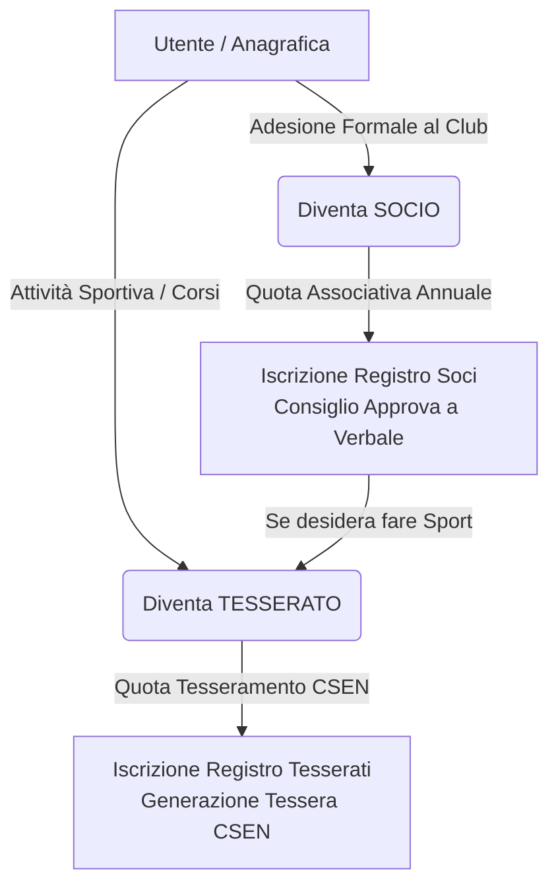

# Logiche di Sistema: Socio vs Tesserato

Questo documento descrive le regole di business e i flussi interni del portale Adrenalina Club per la gestione dei ruoli **Socio** e **Tesserato**.

---

## 1. Definizione dei Ruoli

*   **SOCIO**:
    *   Effettua l'adesione formale all'associazione culturale/sportiva.
    *   Paga la **Quota Associativa Annuale** (gestita in `registro_soci.quota_scadenza`).
    *   Viene iscritto nel registro soci dopo la delibera e firma del verbale del Consiglio Direttivo.
    *   **Non ha abilitazione all'attività sportiva automatica** e non riceve una tessera CSEN per il solo fatto di essere socio.
    *   Può partecipare alle assemblee sociali ed eventi associativi non sportivi.

*   **TESSERATO**:
    *   Viene inserito nel `registro_tesserati` con una richiesta di tesseramento sportivo.
    *   Riceve una **Tessera CSEN** e relativa copertura assicurativa.
    *   Paga la quota del tesseramento CSEN.
    *   Può partecipare ai corsi sportivi (es. Calisthenics, Strongman) previa validità del **Certificato Medico**.
    *   Paga la quota del corso (mensile, trimestrale, ecc.) con una specifica data di inizio e di fine corso.
    *   Non è necessariamente un Socio (può essere un "Tesserato Esterno" che partecipa solo alle attività sportive).

---

## 2. Flusso di Interazione

Un utente può accumulare entrambi i ruoli (Socio e Tesserato). Per frequentare attività sportive, un Socio **deve** tesserarsi.

---

## 3. Gestione Scadenze Corsi

*   In fase di iscrizione, l'atleta indica la **Data Inizio Corso**. Questa non può essere antecedente alla data di richiesta del suo tesseramento (`registro_tesserati.data_richiesta_tesseramento`).
*   La **Data Scadenza Corso** viene calcolata sommando i mesi previsti dal piano di abbonamento (es. +3 mesi per un trimestrale) e impostando come giorno di scadenza il giorno precedente (es. inizio 12 Gennaio -> scadenza 11 Aprile).
*   L'istruttore ha facoltà di sovrascrivere manualmente la data di scadenza del corso per un atleta. In tal caso, viene mostrato il simbolo **✋ (Manina)** a indicare la forzatura manuale.

---

## 4. Politiche di Durata e Rinnovo (CSEN & Soci)

Esistono tre figure distinte gestite dal portale: **Socio non tesserato**, **Socio e Tesserato** (le due posizioni seguono vie e scadenze indipendenti) e **Solo Tesserato** (la cui iscrizione all'associazione ha la medesima durata della tessera CSEN).

### 4.1. Durata Tessere CSEN (`registro_tesserati.data_scadenza_tessera`)
Calcolata deterministicamente da `public.calcola_scadenza_tessera_csen(data_iscrizione, livello_copertura)` e allineata con la data reale letta dal portale CSEN via `scripts/csen_sync_active.js`:
*   **Base Silver / Gold (`BASE`)** emesse tra `01/01/N` e `31/08/N`: scadono il `31/12/N`.
*   **Base Silver / Gold (`BASE`)** emesse tra `01/09/N` e `31/12/N`: scadono il `31/12/(N+1)`.
*   **Integrativa A e B (`INTEGRATIVA_A`, `INTEGRATIVA_B`)**: scadono **365 giorni** dopo la data di iscrizione/rinnovo.

### 4.2. Status Socio & Morosità (`registro_soci`)
*   L'iscrizione a Socio è **a tempo indeterminato**, ma la quota associativa annuale va saldata entro il **`31/12`** di ogni anno.
*   Dal **`01/01`** successivo alla scadenza senza rinnovo (`quota_scadenza < oggi`), il Registro Soci segnala il socio con il badge **`MOROSO / SCADUTO`** e consente al Consiglio Direttivo di deliberarne la decadenza (`stato_socio = 'DECADUTO'`, con storicizzazione di `data_decadenza` e `verbale_decadenza`).

### 4.3. Finestre di Rinnovo Online (Dashboard Utente)
*   **Quota Socio**: rinnovabile in dashboard a partire dal **`1° Novembre`** dell'anno di scadenza (`N-1` per l'anno `N`).
*   **Tessera CSEN**: rinnovabile in dashboard a partire da **60 giorni prima** della `data_scadenza_tessera` (o se scaduta), con possibilità di confermare o cambiare copertura (es. passaggio da Silver a Integrativa B) previa validità di Documento d'Identità e Certificato Medico (`VERDE`).
*   Per i **Soci e Tesserati** le due posizioni sono rinnovabili insieme o separatamente tramite il flusso dedicato `type: 'rinnovo_annuale'` su [create-checkout-session.js](../api/create-checkout-session.js) e [stripe-webhook.js](../api/stripe-webhook.js).
