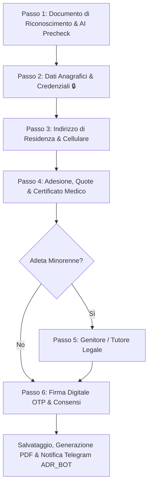

# Registration Flow: Athlete Portal

The registration wizard is implemented in [registrazione.html](../portal/registrazione.html). It provides a secure, six-step onboarding funnel for incoming athletes joining Adrenalina Club.

---

## 🗺️ Step Funnel Breakdown (v1.06.08+)

### 1. Passo 1: Documento di Riconoscimento (AI Fast-Onboarding)
- Caricamento preventivo del documento d'identità (Fronte e Retro separati o file unico).
- **GDPR & Privacy Zero-Retention**: il documento non viene caricato preventivamente su storage permanente ma analizzato in tempo reale su server europei conformi via Mistral Vision (`pixtral-12b-2409`).
- Estrazione automatica accurata: `nome`, `cognome`, `codice_fiscale`, `tipo_documento`, `data_scadenza`, `indirizzo_residenza` (via e civico), `comune_residenza`.
- **Validazione Ministeriale Codice Fiscale**: verifica server-side del formato e dell'algoritmo di controllo/checksum dell'Agenzia delle Entrate (`isValidCodiceFiscale`). Per le carte d'identità, se il CF manca o fallisce il checksum, declassamento preventivo a `GIALLO`.
- L'utente conferma i dati estratti con token HMAC firmato oppure ricarica (max 2 tentativi) o invia a revisione del Direttivo.

### 2. Passo 2: Dati Anagrafici & Credenziali
- **Autofill Intelligente**: Nome, Cognome e Codice Fiscale vengono precompilati dai dati del documento.
- **Decodifica CF**: Data di nascita, sesso, provincia e comune di nascita vengono calcolati e compilati automaticamente tramite l'algoritmo catastale del Codice Fiscale.
- **Protezione Anti-Frode (Campi Bloccati 🔒)**: I campi anagrafici (inclusi comune e provincia di nascita) sono impostati in sola lettura (`readonly` / `disabled`).
- **Sblocco Manuale Auditabile**: Se i dati letti dall'AI contengono errori o discrepanze, l'utente può cliccare sul tasto dedicato *"MODIFICA DATI A MANO"*. L'azione richiede conferma esplicita e attiva il flag `anagraficaModificataManualmente = true`, che forza **l'invio obbligatorio a controllo manuale del Consiglio Direttivo** con stato `GIALLO`.
- Inserimento credenziali di accesso (Email e Password con checklist di complessità).

### 3. Passo 3: Indirizzo di Residenza & Contatti
- Compilazione automatica dell'indirizzo e del comune estratti dalla carta d'identità.
- **Residenza Libera (Non Bloccante)**: L'utente può sempre modificare o correggere liberamente via, comune, provincia e CAP (anche per documenti che non riportano l'indirizzo, come patenti di guida UE o passaporti). La modifica dell'indirizzo non blocca la pratica.
- **Cellulare Obbligatorio**: Campo inserito come requisito essenziale per comunicazioni urgenti e coordinamento corsi.

### 4. Passo 4: Adesione, Quote & Certificato Medico
- Selezione tipologia adesione (*Tesserato*, *Socio + Tesserato*, *Socio*).
- Selezione Tessera Sportiva se atleta (*Silver*, *Gold*, *Integrativa A/B*).
- Caricamento Certificato Medico con precheck AI Mistral in tempo reale (estrazione tipologia e scadenza).

### 5. Passo 5: Dati Genitore / Tutore (Solo Minorenni)
- Mostrato condizionalmente se l'età calcolata dalla data di nascita è < 18 anni.
- Richiede dati legali del genitore/tutore e precheck AI del rispettivo documento d'identità.

### 6. Passo 6: Firma Digitale OTP, Consensi & Notifica Telegram ADR_BOT
- Firma elettronica avanzata con codice OTP via email.
- Consensi GDPR, audiovisivi e marketing.
- Verifica firma HMAC di token doc e token cert su `/api/otp-verify.js`.
- **Anti-Bypass Guard Server-Side (v1.06.09)**: il server non si fida del flag client `doc_modificato_manualmente`, ma confronta in modo non manomettibile `nome`, `cognome` e `codice_fiscale` del profilo salvato con quelli crittografati nel `doc_token`. In caso di discrepanza, la pratica viene forzata a stato `GIALLO` per revisione manuale.
- **Notifica Push Telegram Istantanea (`api/_utils/telegram-bot.js`)**: Quando una registrazione viene archiviata con richiesta di delibera o approvazione manuale (nuovi soci, documenti `GIALLO`, modifiche anagrafiche a mano), il server invia con `await` asincrono garantito una notifica formattata ad **ADR_BOT** sul canale Telegram del Consiglio Direttivo con link diretto al pannello approvazioni della dashboard.

---

## 🧠 Smart Client-Side Validations & Layout Rules

1.  **Default Layout Documenti "Due File Separati" (v1.03.49)**: La modalità predefinita per il caricamento del documento d'identità è impostata su "HO DUE FILE SEPARATI" rendendo visibili sia la casella Fronte che Retro per evitare che gli utenti mobile carichino solo il retro (causando blocchi AI o stati GIALLO non necessari).
2.  **Avviso Modalità File Unico**: In modalità "HO UN FILE UNICO", viene mostrato un avviso visivo dedicato (`#avviso-single-mode`) che ricorda di caricare entrambe le facce.
3.  **Tastiera Numerica ed Autocompletamento Mobile**: L'input `#otp_code` include gli attributi `inputmode="numeric" pattern="[0-9]*" autocomplete="one-time-code"` per attivare la tastiera numerica ed il rilevamento automatico del codice OTP da SMS/email su iOS e Android.
4.  **Italian Codice Fiscale Algorithm**: Validates Italian tax code formatting and check character checksums.
5.  **Cascading Municipality Selection**: Fetches Italian municipalities directly from an open-source dataset, automatically populating and filtering Province, Commune, and ZIP/CAP codes based on selection.
6.  **Dynamic Age Calculations**: Parses the birthdate input, comparing it to current time to flag minor status and display the parental guardian input step (Step 5).
7.  **Medical Certificate Emission Date Validation**: Ensures the medical certificate emission date entered by the user is not in the future relative to the registration date (v1.03.26).
8.  **Browser Credential Autofill Prevention**: Form inputs use `autocomplete="off"` for email and `autocomplete="new-password"` for password to prevent modern browsers from pre-filling fields with administrative/President credentials during new registration sessions (v1.03.26).
9.  **Storicizzazione vs Cleanup Incompleti**: Come chiarito dalle regole operative del progetto, la *EPIKA CORE RULE* (storicizzazione distruttiva via `attivo` / `data_fine`) si applica **SOLO a soggetti che hanno superato la fase di registrazione**. Per le registrazioni mai completate o abbandonate prima della firma OTP, è consentita l'eliminazione fisica diretta senza traccia storica.

